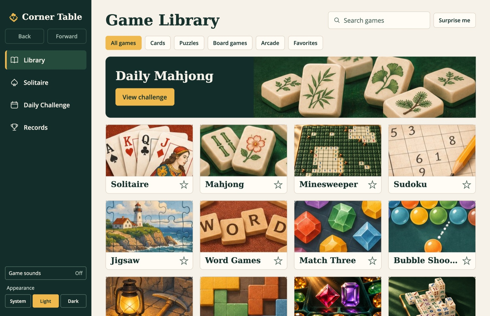
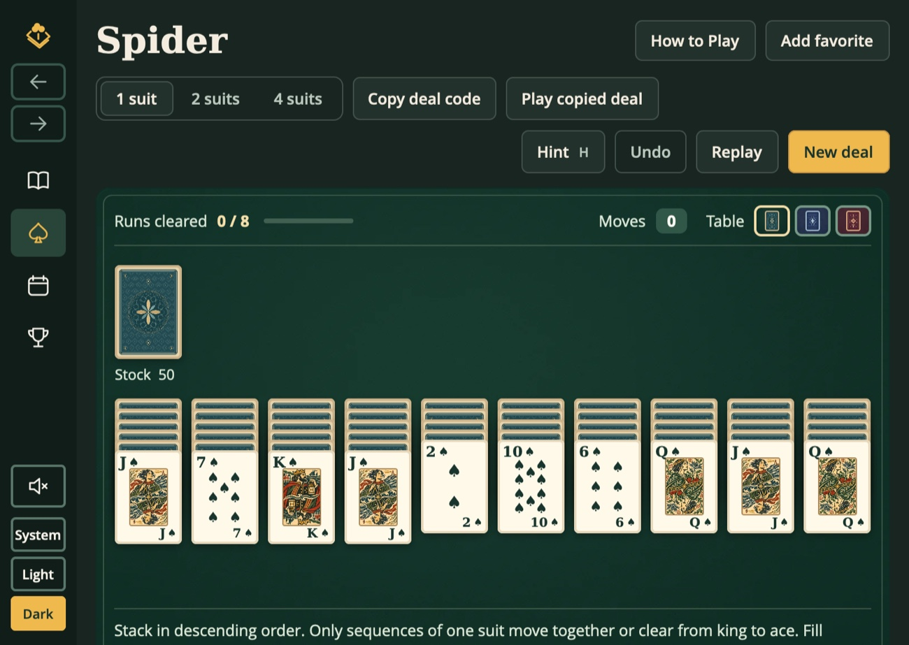
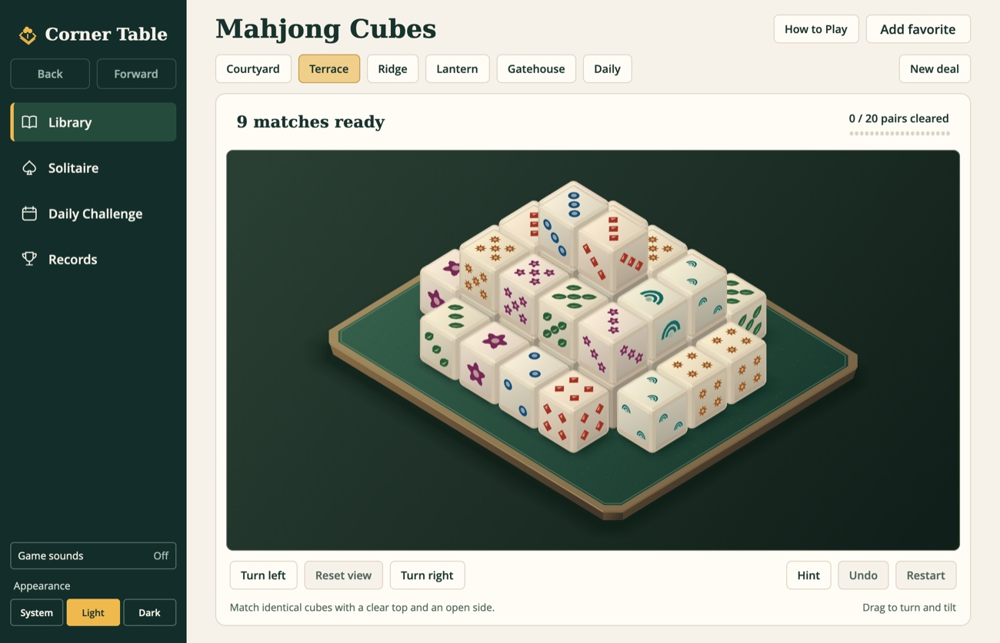

# Corner Table

An offline desktop collection of 21 classic card, board, and puzzle games, with original artwork and native keyboard and mouse controls. Play a quick round, pick a game with **Surprise me**, or work through the daily calendar. Your games, favorites, and records carry over between sessions.



[Browse all games](games/README.md) · [Download Corner Table](https://github.com/karbowiak/CornerTable/releases/latest) · [Share feedback](https://github.com/karbowiak/CornerTable/issues/new)

## Play

| Platform | Release archive | Open |
| --- | --- | --- |
| Windows x64 | `corner-table-windows-x86_64.zip` | Extract and run `corner-table.exe`. |
| Linux x86-64 | `corner-table-linux-x86_64.tar.gz` | Extract and run `./corner-table` from the extracted folder. Requires a Wayland or X11 desktop and a Vulkan driver. |
| macOS Apple silicon | `corner-table-macos-arm64.zip` | Extract and open `Corner Table.app`. The preview build has an ad hoc signature. |

Use **How to Play** or press **F1** for rules and controls. The sidebar follows your system appearance by default, and **View → Always Reduce Motion** reduces gameplay effects. The macOS build offers a **Game sounds** toggle.

Share the starting layout in Solitaire, Mahjong, and Minesweeper with a deal or field code. **File → Export Progress…** saves your preferences, sessions, and results as JSON. Imported Jigsaw photos stay in the local gallery.

| Spider Solitaire | Mahjong Cubes |
| --- | --- |
|  |  |

## Build from source

The workspace uses Rust and GPUI. CI builds with Rust 1.100.0.

- **macOS** requires Apple’s Command Line Tools. Use `cargo xtask bundle` to create `target/Corner Table.app`.
- **Windows** requires the MSVC tools and Windows SDK. Release builds use `fxc.exe` from the SDK. Use `cargo build --locked --release -p corner-table` to create `target/release/corner-table.exe`.
- **Linux** requires the compiler and desktop development libraries listed in [the CI setup script](scripts/ci-linux-deps.sh). Use `cargo build --locked --release -p corner-table` to create `target/release/corner-table`.

Run `cargo run --locked` to start the app during development. Use [Dioxus CLI 0.7.10](https://github.com/DioxusLabs/dioxus/releases/tag/v0.7.10) with `cargo xtask dev` for GPUI hot reload. Press `r` after changing data layouts, dependencies, or bundled assets. `cargo xtask dev --restart` uses Python 3 to rebuild and reopen the app after a successful build.

## Contribute

Install `rustfmt` and `clippy`, then enable the repository hooks in your checkout.

```sh
git config --local core.hooksPath .githooks
bash scripts/check.sh
```

On Windows, run the shell commands in Git Bash. The commit hook checks formatting and Clippy against staged Rust changes. The push hook runs those checks plus workspace tests against the commits being sent. GitHub Actions runs the same checks and builds the release archives. A `v` tag matching the workspace version publishes the archives and `SHA256SUMS` to GitHub Releases.

Game rules live in `games/`, GPUI views and assets in `apps/desktop/`, and the offline catalog in `crates/api/fixtures/`. Release archives include third-party notices. [Audio sources and attribution](apps/desktop/local-audio/README.md)
